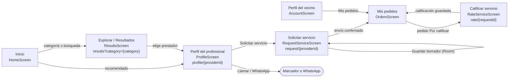
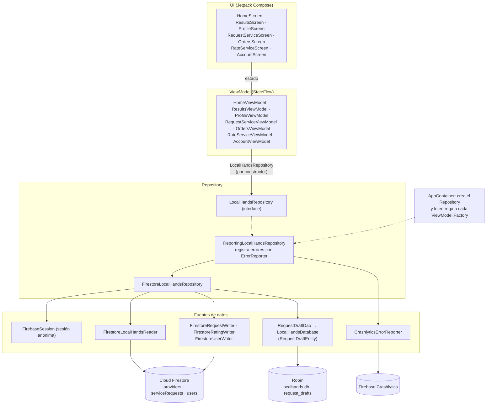

# LocalHands

App Android para que los vecinos de colonias y edificios encuentren a alguien confiable y disponible para reparar algo en su casa, le pidan el servicio y lo califiquen al terminar.

Integrantes: James Sipac, Iván Roblero y Jair Morales. Universidad del Valle de Guatemala, Plataformas Móviles, 2026.

## 1. Problema y solución

**Usuario:** vecinos e inquilinos que necesitan una reparación en el hogar (plomería, electricidad, carpintería, jardinería o electrodomésticos).

**Problema validado:** en las entrevistas, encontrar a alguien no era lo difícil; lo difícil era encontrar a alguien disponible y dispuesto a tomar el trabajo. Irving Gonzales, vecino que necesitaba reparar una fuga de agua, lo resumió así: *"No es solo encontrar a alguien, sino encontrar a alguien disponible y dispuesto a tomar el trabajo."* Hoy dependen de recomendaciones de familiares o conocidos, que pueden tardar días en responder.

**Propuesta de valor:** LocalHands conecta a vecinos e inquilinos con prestadores de servicios de reparación para el hogar, permitiéndoles encontrar y contactar rápidamente a una persona confiable, a diferencia de las recomendaciones informales de familiares o conocidos, que pueden tardar varios días en responder. El vecino consulta perfiles, disponibilidad y reseñas antes de solicitar el servicio.

## 2. Cómo ejecutar

| Requisito | Versión |
|---|---|
| Android Studio | Quail 3 (2026.1.3) o más reciente; cualquier versión que soporte AGP 9.3 |
| Android Gradle Plugin | 9.3.3 |
| Gradle (wrapper incluido) | 9.5.0 |
| Kotlin | 2.2.10 |
| JDK | 21 (el que trae Android Studio) |
| `compileSdk` | 37 |
| `minSdk` | 26 (Android 8.0) |
| `targetSdk` | 36 |

Pasos:

1. Clonar el repositorio y cambiar a la rama de la entrega:
   ```
   git clone https://github.com/Jimaa07/Proyect-Plataformas.git
   cd Proyect-Plataformas
   git checkout entrega-final
   ```
2. En Android Studio: **File > Open** y elegir la carpeta raíz del proyecto (la que tiene `settings.gradle.kts`, no la carpeta `app`).
3. Esperar a que termine **Gradle Sync**. Si Android Studio pide instalar la plataforma de Android 37 o herramientas del SDK, aceptar.
4. Elegir un emulador o un teléfono con Android 8.0 o superior y tocar **Run 'app'**.

No hace falta configurar Firebase: [`app/google-services.json`](app/google-services.json) ya está en el repositorio y la app inicia una sesión anónima sola. La primera vez que se abre necesita conexión para iniciar la sesión y descargar los prestadores; después funciona con los datos guardados en el teléfono.

Pruebas unitarias y APK de debug:
```
./gradlew testDebugUnitTest assembleDebug
```
El APK queda en `app/build/outputs/apk/debug/app-debug.apk`. Se firma con la llave compartida [`app/debug.keystore`](app/debug.keystore), así un APK generado en cualquier computadora del equipo se instala como actualización.

Para probar la calificación: las solicitudes nuevas quedan como "Enviada" (`SENT`). Marcar un trabajo como terminado le corresponde al prestador, que está fuera del alcance, así que para calificar se cambia `status` a `TO_RATE` en el documento de `serviceRequests` desde la consola de Firestore.

## 3. Flujo de usuario



La barra inferior ([`AppBottomBar`](app/src/main/java/com/uvg/localhands/ui/components/AppBottomBar.kt)) cambia entre **Inicio**, **Explorar**, **Mis pedidos** y **Perfil**. El botón Atrás regresa a la pantalla anterior; en Solicitar servicio, si hay cambios sin guardar, primero pregunta si guardar el borrador. Rutas en [`Route.kt`](app/src/main/java/com/uvg/localhands/navigation/Route.kt) y grafo en [`LocalHandsNavHost.kt`](app/src/main/java/com/uvg/localhands/navigation/LocalHandsNavHost.kt).

## 4. Arquitectura



- Las pantallas reciben el estado y avisan los eventos con callbacks; no conocen el Repository.
- Cada ViewModel recibe `LocalHandsRepository` por constructor desde su `Factory`, que lo toma de [`AppContainer`](app/src/main/java/com/uvg/localhands/di/AppContainer.kt).
- El Repository devuelve modelos de dominio de [`data/model`](app/src/main/java/com/uvg/localhands/data/model) (`Provider`, `ServiceRequest`, `UserProfile`, `RequestDraft`). Los documentos de Firestore (`ProviderDocument`, `ServiceRequestDocument`, `UserDocument`) y la entidad de Room no salen de la capa de datos.
- [`ReportingLocalHandsRepository`](app/src/main/java/com/uvg/localhands/data/repository/ReportingLocalHandsRepository.kt) envuelve al Repository de Firestore: si una operación falla, registra el error como no fatal en Crashlytics y lo devuelve igual al ViewModel.

## 5. Mínimos técnicos

| ID | Qué cumple | Dónde |
|---|---|---|
| M1 | Pantallas del flujo principal y tema propio (colores y tipografía) aplicado en toda la app. | [`Theme.kt`](app/src/main/java/com/uvg/localhands/ui/theme/Theme.kt), [`Color.kt`](app/src/main/java/com/uvg/localhands/ui/theme/Color.kt), [`Type.kt`](app/src/main/java/com/uvg/localhands/ui/theme/Type.kt), [`ui/screens`](app/src/main/java/com/uvg/localhands/ui/screens) |
| M2 | Navigation Compose; `profile/{providerId}`, `request/{providerId}` y `rate/{requestId}` reciben argumento; Atrás regresa a la pantalla anterior. | [`Route.kt`](app/src/main/java/com/uvg/localhands/navigation/Route.kt), [`LocalHandsNavHost.kt`](app/src/main/java/com/uvg/localhands/navigation/LocalHandsNavHost.kt) |
| M3 | `LazyColumn` con `key` por id en Inicio, Resultados, Mis pedidos y reseñas. | [`HomeScreen.kt` L177](app/src/main/java/com/uvg/localhands/ui/screens/HomeScreen.kt#L177), [`ResultsScreen.kt` L240](app/src/main/java/com/uvg/localhands/ui/screens/results/ResultsScreen.kt#L240), [`OrdersScreen.kt` L121](app/src/main/java/com/uvg/localhands/ui/screens/orders/OrdersScreen.kt#L121) |
| M4 | Formulario de solicitud con 4 campos validados en tiempo real (descripción, zona, fecha, horario), error junto a cada campo y botón habilitado solo si es válido. También el formulario del perfil del vecino. | [`RequestValidation.kt`](app/src/main/java/com/uvg/localhands/ui/screens/request/RequestValidation.kt), [`RequestServiceScreen.kt`](app/src/main/java/com/uvg/localhands/ui/screens/request/RequestServiceScreen.kt), [`ProfileValidation.kt`](app/src/main/java/com/uvg/localhands/ui/screens/account/ProfileValidation.kt) |
| M5 | Un ViewModel por pantalla con lógica, estado inmutable en `StateFlow` (`stateIn`/`asStateFlow`) que sobrevive a la rotación; los Composables reciben estado y callbacks. | [`RequestServiceViewModel.kt`](app/src/main/java/com/uvg/localhands/ui/screens/request/RequestServiceViewModel.kt), [`HomeViewModel.kt`](app/src/main/java/com/uvg/localhands/ui/screens/HomeViewModel.kt), [`FormStates.kt`](app/src/main/java/com/uvg/localhands/ui/state/FormStates.kt) |
| M6 | Todo acceso a datos pasa por el Repository; ninguna pantalla ni ViewModel importa `com.google.firebase` ni `androidx.room`. | [`LocalHandsRepository.kt`](app/src/main/java/com/uvg/localhands/data/repository/LocalHandsRepository.kt), [`data/repository`](app/src/main/java/com/uvg/localhands/data/repository) |
| M7 | El ViewModel recibe el Repository por constructor desde su `Factory`. | [`RequestServiceViewModel.kt` L330](app/src/main/java/com/uvg/localhands/ui/screens/request/RequestServiceViewModel.kt#L330), [`AppContainer.kt`](app/src/main/java/com/uvg/localhands/di/AppContainer.kt) |
| M8 | Operaciones `suspend` o `Flow`, lanzadas desde `viewModelScope`. | [`LocalHandsRepository.kt`](app/src/main/java/com/uvg/localhands/data/repository/LocalHandsRepository.kt), `submit()` en [`RequestServiceViewModel.kt`](app/src/main/java/com/uvg/localhands/ui/screens/request/RequestServiceViewModel.kt) |
| M9 | Lee la colección `providers`; crea documentos en `serviceRequests` al enviar una solicitud, actualiza `providers` y `serviceRequests` al calificar y guarda `users/{uid}`; devuelve `data class` de dominio. | [`FirestoreLocalHandsReader.kt`](app/src/main/java/com/uvg/localhands/data/repository/FirestoreLocalHandsReader.kt), [`FirestoreRequestWriter.kt`](app/src/main/java/com/uvg/localhands/data/repository/FirestoreRequestWriter.kt), [`FirestoreRatingWriter.kt`](app/src/main/java/com/uvg/localhands/data/repository/FirestoreRatingWriter.kt), [`FirestoreUserWriter.kt`](app/src/main/java/com/uvg/localhands/data/repository/FirestoreUserWriter.kt) |
| M10 | Estados de carga, error con Reintentar y vacío; sin conexión muestra los datos guardados con un aviso y nunca se queda cargando (tiempo límite de 15 s para la sesión). | [`ContentStatus.kt`](app/src/main/java/com/uvg/localhands/ui/state/ContentStatus.kt), [`ContentStatusViews.kt`](app/src/main/java/com/uvg/localhands/ui/components/ContentStatusViews.kt), [`FirebaseSession.kt`](app/src/main/java/com/uvg/localhands/data/repository/FirebaseSession.kt) |
| M11 | Room con Entity, DAO y Database: el borrador de la solicitud sobrevive a cerrar y reabrir la app. | [`RequestDraftEntity.kt`](app/src/main/java/com/uvg/localhands/data/repository/RequestDraftEntity.kt), [`RequestDraftDao.kt`](app/src/main/java/com/uvg/localhands/data/repository/RequestDraftDao.kt), [`LocalHandsDatabase.kt`](app/src/main/java/com/uvg/localhands/data/repository/LocalHandsDatabase.kt) |
| M12 | Convenciones del curso: paquete `com.uvg.localhands`, PascalCase y camelCase, componentes con `modifier: Modifier = Modifier`, sin restos de plantilla. | [`ui/components`](app/src/main/java/com/uvg/localhands/ui/components), [`app/build.gradle.kts`](app/build.gradle.kts) |
| M13 | Crashlytics: los errores que captura el Repository se registran como no fatales, con la clave `repository_operation`. | [`ReportingLocalHandsRepository.kt`](app/src/main/java/com/uvg/localhands/data/repository/ReportingLocalHandsRepository.kt), [`CrashlyticsErrorReporter.kt`](app/src/main/java/com/uvg/localhands/data/repository/CrashlyticsErrorReporter.kt), [prueba](app/src/test/java/com/uvg/localhands/data/ReportingLocalHandsRepositoryTest.kt) |
| M14 ★ | Build 1.1 (versionCode 2) en Firebase App Distribution con notas de versión, descargado por 2 testers externos (captura en el PR). Firma compartida para que cada build se instale como actualización. | [`app/build.gradle.kts`](app/build.gradle.kts) (`versionCode`, `signingConfigs`), [`app/debug.keystore`](app/debug.keystore) |
| M15 ★ | Sin bugs críticos en el flujo principal. Los hallazgos del cross-review se corrigieron: sin conexión la solicitud se guarda como borrador, y Atrás con cambios pide confirmación. 117 pruebas unitarias. | [`RequestServiceViewModelTest.kt`](app/src/test/java/com/uvg/localhands/ui/screens/request/RequestServiceViewModelTest.kt), [`app/src/test`](app/src/test/java/com/uvg/localhands) |

**Permisos:** la app no pide permisos protegidos. Llamar abre el marcador con `ACTION_DIAL`, que no necesita permiso.

## 6. Alcance

Alcance congelado en la Entrega 4.

| User story | Alcance | ¿Se cumplió? |
|---|---|---|
| Como vecino, quiero buscar y filtrar prestadores por categoría, nombre o zona para encontrar a alguien cerca. | Dentro | Sí |
| Como vecino, quiero ver el perfil de un prestador (experiencia, zonas, disponibilidad y reseñas) para decidir si lo contacto. | Dentro | Sí |
| Como vecino, quiero contactar al prestador por llamada o WhatsApp. | Dentro | Sí |
| Como vecino, quiero enviar una solicitud con descripción, zona, fecha y horario, y verla en Mis pedidos. | Dentro | Sí |
| Como vecino, quiero guardar un borrador de la solicitud y retomarlo después, aunque cierre la app. | Dentro | Sí |
| Como vecino, quiero calificar un trabajo terminado para que otros vecinos vean mi reseña. | Dentro | Sí (el pedido se marca como terminado desde la consola) |
| Como vecino, quiero guardar mi nombre y zona para que mis reseñas lleven mi nombre. | Dentro | Sí |
| Inicio de sesión con cuenta propia y cambio de cuenta. | Fuera | Se usa sesión anónima de Firebase. |
| App o panel del prestador para aceptar pedidos y marcarlos como terminados. | Fuera | |
| Pagos, chat dentro de la app, notificaciones y geolocalización. | Fuera | |
| Enviar una solicitud nueva estando sin conexión. | Fuera | Se guarda como borrador y se envía al volver la conexión. |

## 7. Referencias y uso de IA

**Documentación consultada**

- Material del curso Plataformas Móviles: laboratorios y guías de las semanas de Compose, navegación, MVVM, corrutinas, Repository, Firestore y Room.
- Android Developers: [Jetpack Compose](https://developer.android.com/develop/ui/compose/documentation), [Navigation Compose](https://developer.android.com/develop/ui/compose/navigation), [Guía de arquitectura de apps](https://developer.android.com/topic/architecture), [ViewModel](https://developer.android.com/topic/libraries/architecture/viewmodel), [StateFlow](https://developer.android.com/kotlin/flow/stateflow-and-sharedflow), [Room](https://developer.android.com/training/data-storage/room), [Inyección manual de dependencias](https://developer.android.com/training/dependency-injection/manual).
- Firebase: [Cloud Firestore](https://firebase.google.com/docs/firestore), [Reglas de seguridad](https://firebase.google.com/docs/firestore/security/get-started), [Autenticación anónima](https://firebase.google.com/docs/auth/android/anonymous-auth), [Crashlytics: excepciones no fatales](https://firebase.google.com/docs/crashlytics/android/customize-crash-reports), [App Distribution](https://firebase.google.com/docs/app-distribution/android/distribute-console).

**Declaración de uso de IA**

| Herramienta | Para qué se usó | Partes asistidas |
|---|---|---|
| ChatGPT / Codex | Entender requisitos, revisar el proyecto y proponer código. | Borrador de la solicitud con Room y sus pruebas; parte de la documentación de la Entrega 4. |
| Claude | Proponer e implementar cambios, revisar código y redactar documentación. | Correcciones de las observaciones de la Entrega 4 (perfil del vecino en Firestore, contacto por llamada y WhatsApp, renombre del paquete), integración de Crashlytics, correcciones del cross-review, pruebas unitarias, este README y la descripción del PR. |

**Cómo se verificó:** el equipo revisó cada cambio antes de integrarlo, corrió `./gradlew testDebugUnitTest assembleDebug` antes de publicar cada build, probó el flujo principal en teléfonos reales (incluido modo avión y cerrar y reabrir la app), confirmó los eventos no fatales en la consola de Crashlytics y probó las reglas de Firestore. Las decisiones del producto, las entrevistas, las pruebas con usuarios y el cross-review son del equipo.
